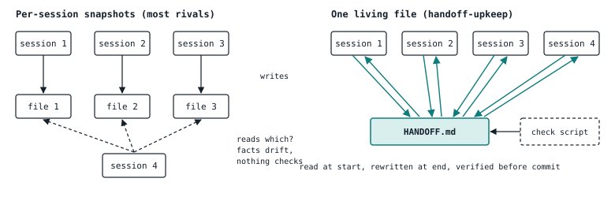
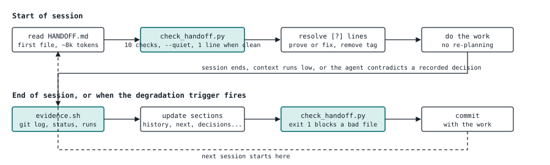
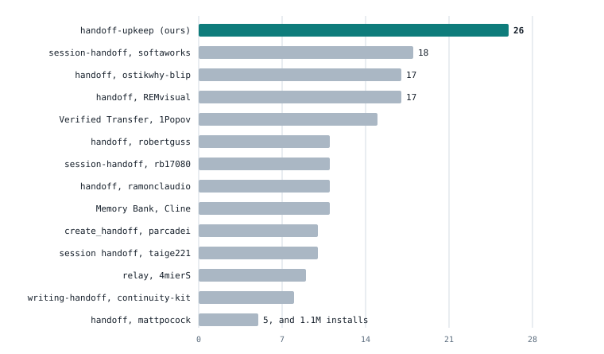
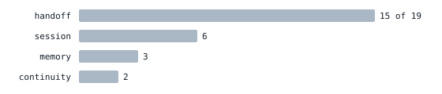

# handoff-upkeep

One start-here file per project, kept true by a script, so every new AI session begins with the goal, the decisions and their reasons, what shipped, what is next, the numbers, the renewals and the traps.

handoff-upkeep is a skill for Claude Code and any agent that reads Agent Skills folders. It comes in three sizes, lite (5 sections), standard (10) and full (15), chosen by one line in the file. A check script refuses stale dates, shipped items still listed as next, secrets and unverified claims, and prints one line when the file is clean. An evidence script collects commits, git status and the last test run at the end of a session. Claim tags, a do-not-retry list and a degradation trigger keep the file honest between sessions. It was built on, and is used daily by, a live one-person SaaS, and this is version 1.4.0.

## Install

1) Copy this folder to `~/.claude/skills/handoff-upkeep/`, or to a project's `.claude/skills/handoff-upkeep/`.
2) At the end of a session, invoke `/handoff-upkeep`.
3) Start a new file with `python3 scripts/check_handoff.py --new standard HANDOFF.md` (or `lite`, or `full`).
4) Check a file with `python3 scripts/check_handoff.py HANDOFF.md --quiet`.

The start of a session needs only the handoff and the quiet check, not the skill. The scripts need only Python 3 and bash, no packages.

## Files

- `SKILL.md`: when to use it, the start and end procedures, claim tags, the degradation trigger, the rules.
- `scripts/check_handoff.py`: the check script, PASS, WARN or FAIL per check, `--new` writes a skeleton, `--selftest` tests it.
- `scripts/evidence.sh`: end-of-session evidence, commits since Last updated, git status, test command, last run log.
- `references/SECTIONS.md`: what goes in each of the fifteen sections, and how to create a handoff.
- `references/HANDOFF-TEMPLATE.md`: the fifteen-section template (Profile: full).
- `examples/HANDOFF-example.md`: a sanitized excerpt of a real handoff.
- `CHANGELOG.md`: versions.
- `docs/`: the report below as a web page, with its figures in `docs/img/`.

## The report

Also published as a page: https://aminafara123.github.io/handoff-upkeep/

*How it works, and why it should convince you. Version 1.3.0, Nov 10 2026*

### Handoff Upkeep

One start-here file per project, rewritten at the end of every AI session and checked by a script, so the next session begins with the goal, the decisions and their reasons, what shipped, what is next, the numbers, the renewals and the traps. Not a transcript summary, a living document.

| Number | Meaning | Source |
|---|---|---|
| 19 | similar skills compared, 13 read in full | research, Nov 10 2026 |
| 5 / 10 / 15 | sections in the lite, standard and full profiles | SECTIONS.md |
| 399 | lines in the live handoff it maintains | git, Nov 10 2026 |
| 27 | edits to that file in 5 working days | git log, Nov 3 to 10 |
| 61 | commits the file kept up with | git log since Nov 3 |
| 5 | mechanisms adopted from the best rivals | CHANGELOG 1.1.0 |

### The problem it solves

A session of agent work ends and its context is gone. The next session knows the code but not the reasons. It reopens settled decisions, rebuilds a feature that shipped last week, and asks the owner questions they already answered. Most handoff skills answer this by summarizing the chat into a new file every time. Those files pile up, disagree with each other, and nobody checks them.

<picture><source media="(prefers-color-scheme: dark)" srcset="docs/img/problem-dark.svg"></picture>

*Twelve of thirteen readable rivals write a new file per session. Handoff Upkeep keeps one file that every session reads at the start and rewrites at the end, and a script refuses the rewrite when it finds stale dates, shipped items still listed as next, secrets, or unverified claims.*

### How a session runs

The skill is two short procedures and two scripts. Everything mechanical is a script call so the agent reads one compact output instead of running eight commands.

<picture><source media="(prefers-color-scheme: dark)" srcset="docs/img/flow-dark.svg"></picture>

*The highlighted boxes are the script calls. Before version 1.1 the agent ran those checks by hand with greps. Now it reads one short output at the start and one at the end, and the skill file itself is loaded once, at the end.*

#### What the check script refuses

1) A "Last updated" date older than the newest commit.
2) A missing or misordered section.
3) Relative time words in facts ("$21 a year today"). Procedures may keep them.
4) TODO, TBD or ??? that is not phrased as a question for the owner.
5) A "What is next" bullet whose words match a commit subject since the last update (maybe shipped).
6) Any secret pattern (API keys, tokens, passwords, private keys). This one is a hard fail.
7) Lines tagged `[?]` older than seven days (claims never verified).
8) A file over 5,000 tokens (warn, past that size Claude Code drops it after compaction) or 12,000 (fail), because a handoff nobody reads is no handoff.
9) More than six history entries, or an entry over five lines: older entries belong in the linked archive, details belong in git.
10) Dense lines in fact sections: long asides in parentheses or filler words. One fact per line.

### What the file holds

Fifteen sections in a fixed order. The first two are the ones most handoffs lack and the ones a new session needs most.

| # | Section |
|---|---|
| 01 | What this is: product, users, owner, what is live, spend |
| 02 | Goal and strategy: why, success in order, decision dates, who buys, how we win, how customers arrive |
| 03 | Map of the folder: paths, scripts to run instead of hand steps |
| 04 | Secrets and accounts: locations only, never values |
| 05 | Rules for working with the owner |
| 06 | First ten minutes of a session: the checklist |
| 07 | What is done: dated history, facts and numbers |
| 08 | What is next: dated, nearest first, nothing that shipped |
| 09 | Known weak spots |
| 10 | Agents and routines: schedules, models, logs |
| 11 | Decisions and why, plus Tried and rejected, do not retry |
| 12 | Key numbers: prices, limits, caps, ports, spend |
| 13 | Renewals and expiries with dates and the renewal command |
| 14 | Gotchas that cost time: trigger and action, removed once fixed |
| 15 | Words we use: the project's vocabulary |

### Five mechanisms taken from the best rivals

On Nov 10 2026 an Opus research agent read thirteen similar skills in full and scored them. Where a rival did something ours did not, version 1.1 adopted it. Each row names the source so you can check.

| Mechanism | Seen in | How Handoff Upkeep does it |
|---|---|---|
| Automated checks instead of hand greps | softaworks session-handoff: staleness script, "Do not finalize a handoff with secrets detected or score below 70" | `check_handoff.py`, eight checks, exit 1 on any fail, under 15 lines of output when clean |
| Claims tagged verified or remembered | ostikwhy-blip handoff: "[V] only if confirmed by a command or file read during THIS handoff run" | Unverified lines end in `[?]`. The next session proves or fixes them first. The script lists them and warns after seven days |
| Failed approaches kept as a do-not-retry list | ostikwhy-blip ("DO NOT RETRY THESE"), REMvisual, rb17080, robertguss | "Tried and rejected, do not retry" under Decisions and why, one line each with the reason |
| Trigger when the session degrades | ostikwhy-blip: "If you notice degradation... say ONE sentence" | Contradicted a decision, re-derived something settled, misremembered a path, or context low: one sentence to the owner, then the history step now, not at the end |
| Proof of use shipped with the skill | softaworks (evals), REMvisual (changelog and tests) | A sanitized real handoff excerpt, a CHANGELOG, and the measured cost per session below |

### How it compares

Fourteen scores, ours included, on fourteen criteria from 0 to 2. The criteria were written from our own feature list, so the gap flatters us. Read it as "most complete on paper", and read the rows above for where rivals led before 1.1.

<picture><source media="(prefers-color-scheme: dark)" srcset="docs/img/scores-dark.svg"></picture>

*Total of fourteen criteria, each 0 to 2. Source: handoff-skills-comparison-2026-11-10.md, section 3. The most installed skill, mattpocock's 16-line handoff, scores lowest because it only summarizes the chat. That is the market's current idea of a handoff.*

<picture><source media="(prefers-color-scheme: dark)" srcset="docs/img/words-dark.svg"></picture>

*What buyers search for. "Handoff" is in fifteen of nineteen names, which is why ours keeps the word. No rival name uses "start here" or "brief".*

### What it costs per session

Context is the budget. The skill is designed so a session pays for one short instruction file, one read of the handoff, and two compact script outputs. Figures are characters divided by four, an approximation, measured on the live CoiPatrol handoff on Nov 10 2026.

| What the agent reads | When | Approx. tokens |
|---|---|---:|
| SKILL.md (the procedure) | once, at the end of the session | 1,100 |
| HANDOFF.md, 399 lines after the archive rule | start of session | 7,770 |
| check_handoff.py --quiet, one warning | start and end | 96 |
| evidence.sh output | end of session | 294 |
| HANDOFF-HISTORY.md, archived entries | only when an old entry matters | 1,520 |
| references/SECTIONS.md | only when creating a handoff from scratch | 1,110 |

A full session therefore costs about 9,350 tokens of reading, under 5% of a 200,000-token context, and the handoff itself is 83% of that. Version 1.0 cost about 11,900: the procedure was 2,230 tokens and loaded twice, and the agent ran six greps and six git commands by hand. Version 1.1 moved the section definitions into a reference read only when creating a file, and replaced the hand commands with two scripts. Version 1.2 loads the skill once, at the end, prints only warnings, and adds the archive rule: the newest six history entries stay at five lines each, older ones move to a linked file. On the live handoff that rule alone cut the read from 8,700 to 7,750 tokens while keeping every number, name and date in the archive.

1.4.0 (2026-11-10, chars/4): SKILL.md 4,697 chars, about 1,174 tokens. The CoiPatrol handoff unwrapped to 210 lines, 30,579 chars, about 7,650 tokens, still over Claude Code's 5,000-token re-read cap, so the check warns. Quiet check 1,046 chars, about 262 tokens (three warnings), evidence.sh about 294 as before.

#### Three sizes, one line to choose

Not every project needs fifteen sections. A line at the top of the file, `Profile: lite`, `standard` or `full`, picks the section set, and the check script runs only the checks that apply. Two switches, `no-tags` and `no-archive`, drop a mechanism without changing the size. Upgrading is changing the word and adding the sections the check names. Measured by section on the live 398-line handoff:

| Profile | Sections | Read per session | For |
|---|---|---|---|
| lite | 5: what this is, start checklist, what is next, decisions, gotchas | about 2,740 | a side project, a one-week job |
| standard | 10: lite plus goal and strategy, folder map, owner rules, history, key numbers | about 6,190 | most real projects |
| full | 15: standard plus secret locations, weak spots, routines, renewals, vocabulary | about 7,760 | a live product with accounts and schedules |

#### Against the rivals, same yardstick

Characters divided by four, measured Nov 10 2026 on each skill's own files. Rivals that write a new file every session pay in output tokens, the slow and expensive kind. Ours edits about twenty lines.

| Skill | Procedure file | What the next session reads | What each session writes |
|---|---:|---|---|
| handoff-upkeep (ours) | 1,174 | 7,644 for one 210-line file (1.4.0, lines unwrapped), warn at 5,000 tokens, fail at 12,000 | about 450, 21 lines on average over 24 edits |
| handoff, mattpocock | 235 | a chat summary in /tmp, size not stated | a whole summary each session |
| handoff, ostikwhy-blip | 1,470 | about 2,700, target 250 lines, ceiling 400 | the whole file each session, about 2,700 |
| session-handoff, softaworks | 1,580 | a per-session file, size not stated, plus script output | the whole file each session |
| handoff, REMvisual | 3,280 | 6,000 to 16,000, its own target is 300 to 800 lines | the whole file each session, 6,000 to 16,000 |
| Memory Bank, Cline | 1,810 | six files read at every task, sizes depend on the project | the files that changed |
| handoff, ramonclaudio | 3,870 | CONTEXT.md and HANDOFF.md, sizes not stated | both files |
| handoff, robertguss | 1,610 | a session handoff, size not stated | the whole file |
| create_handoff, parcadei | 1,320 | a YAML handoff, size not stated | the whole file |
| session-handoff, rb17080 | 1,150 | HANDOFF.md built from git data, size not stated | the whole file |
| writing-handoff, continuity-kit | 760 | a short topic handoff, size not stated | the whole file |

Without any handoff, a session that rebuilds context from the code reads app.py (about 53,900 tokens), the templates (26,400) and the git log (1,400), around 82,000 tokens, and still learns none of the reasons.

### Evidence from real use

The skill was written on Nov 10 2026 from the practice that produced the CoiPatrol handoff, the start-here file of a live one-person SaaS run by Claude Code agents. That file is the test bed.

1) Created Nov 3 2026. Edited in 27 commits across 5 working days while 61 commits of product work landed. Now 399 lines in 15 sections, with older history in a linked archive.
2) Nov 10, morning audit: three "What is next" bullets still described work that had shipped on Nov 5. A fresh session could have rebuilt it. The audit also found the file said what the product was but not why it existed, which became the Goal and strategy section.
3) Nov 10, first run of the verification checks: two stale facts caught ("$21 a year today", a local model name that no longer matched the health output). The same run exposed a flaw in the skill's own unknowns check, which was fixed before release.
4) Nov 10, research: 19 similar skills found, 13 read in full and scored, five load-bearing claims re-fetched by a second session. Four verified word for word, one not independently reachable (a browser-rendered page).

### Limits, stated plainly

> The scoring criteria came from our own feature list, so the comparison is a completeness check, not a neutral benchmark. The concurrency guard only notices files changed in the last hour and asks the owner, there is no lock. Token figures are approximate. The agensi listing "Session Handoff" could not be read, its 15 sections and 7 uses come from the research agent's fetch alone. Real use is one project over one week.

### Sources

- Research report: handoff-skills-comparison-2026-11-10.md (agensi-research/data), with its Verification section.
- softaworks session-handoff: [SKILL.md](https://github.com/softaworks/agent-toolkit/blob/main/dist/plugins/session-handoff/skills/session-handoff/SKILL.md), [skills.sh page (4.2K installs)](https://skills.sh/softaworks/agent-toolkit/session-handoff)
- ostikwhy-blip handoff: [SKILL.md](https://github.com/ostikwhy-blip/claude-code-handoff-skill/blob/master/SKILL.md)
- mattpocock handoff: [SKILL.md (16 lines)](https://github.com/mattpocock/skills/blob/main/skills/productivity/handoff/SKILL.md), [skills.sh page (1.1M installs)](https://skills.sh/mattpocock/skills/handoff)
- Cline Memory Bank: [memory-bank.mdx](https://github.com/cline/cline/blob/main/docs/best-practices/memory-bank.mdx)
- agensi Session Handoff: [listing](https://www.agensi.io/skills/session-handoff) (not independently verified)
